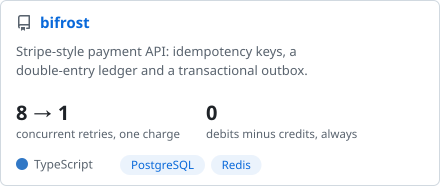
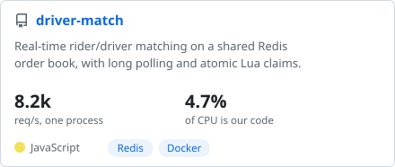
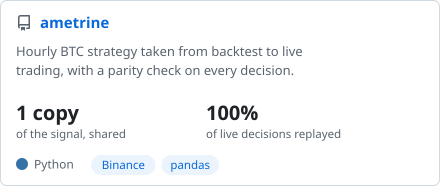

### Hi, I'm Kushal 👋

Final-year iM.Tech at IIIT Bangalore. I build backends and ML systems...

<a href="https://github.com/ZephyrousChimes/bifrost"><picture><source media="(prefers-color-scheme: dark)" srcset="assets/bifrost-dark.svg"></picture></a> <a href="https://github.com/ZephyrousChimes/driver-match"><picture><source media="(prefers-color-scheme: dark)" srcset="assets/driver-match-dark.svg"></picture></a> <a href="https://github.com/ZephyrousChimes/ametrine"><picture><source media="(prefers-color-scheme: dark)" srcset="assets/ametrine-dark.svg"></picture></a>
